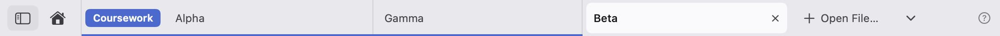
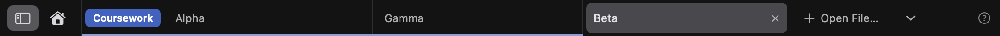

# Tab strip background review

The strip uses neighboring neutral surfaces in light and dark appearance. Selected tabs remain distinct; hover fills and separators follow the same palette. Shapes, grouping, dragging, and controls are unchanged.

Actual AppKit titlebar captures with disposable test documents:

## Light

Before:

After:

## Dark

Before:

After:

Validation: the existing AppKit style checks pass for grouped, ordinary, and single tabs in both appearances. This proposal remains a draft until the user has tried the separate preview and approved the result.
